# RailFlow

**Every seat. Every train. One workspace.**

RailFlow is a multi-tenant web platform that railway, coach and intercity-bus operators use to sell seats, run schedules, manage staff and watch revenue. It replaces spreadsheets, paper seat charts and group chats with one fast, dark-mode console: live bookings with PNRs, per-date seat inventory, fleet schedules, role-based access, an immutable audit trail and revenue reports. Every company gets its own isolated workspace — same deployment, its own branding, users and plan.

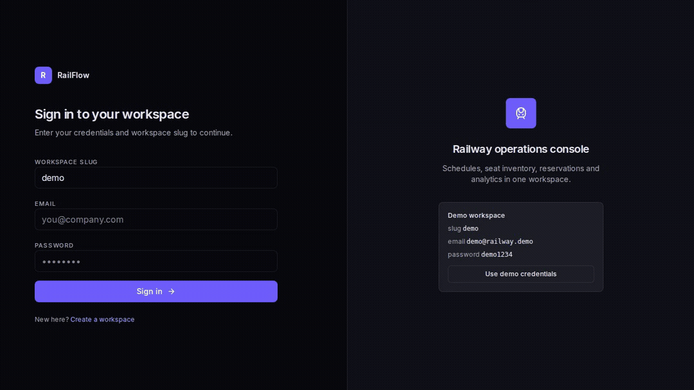

[](docs/TESTING.md)
[](docs/TESTING.md)
[](docs/TESTING.md)
[](docs/TESTING.md)
[](https://nextjs.org)
[](https://fastapi.tiangolo.com)
[](https://www.postgresql.org)

## Contents

- [Why teams switch](#why-teams-switch)
- [Quick start (60 seconds)](#quick-start-60-seconds)
- [Screenshots](#screenshots)
- [Features, and who they are for](#features-and-who-they-are-for)
- [Plans](#plans)
- [🌱 Beginner guide — read this and you are a professional](#-beginner-guide--read-this-and-you-are-a-professional)
- [Architecture](#architecture)
- [Testing & verification](#testing--verification)
- [Project layout](#project-layout)
- [Deployment](#deployment)
- [FAQ](#faq)
- [License](#license)

## Why teams switch

- **Sell a seat in seconds, not minutes.** Search the fleet, pick a date, add passengers, take the fare — RailFlow issues the PNR and updates live inventory. The last seat can never be sold twice.
- **One live picture of the business.** Revenue, bookings, occupancy and cancellations are on the dashboard and in reports, not in a spreadsheet someone emails on Fridays.
- **Everyone sees exactly what they need.** Owners, managers, counter agents and viewers each get the right permissions; departed staff can be switched off in one click.
- **Every sensitive change leaves a trail.** The audit log records who did what, from which IP, to which entity — and cannot be edited from the console.
- **It looks like your company.** Change the logo text, colors and support email in seconds; connect a custom domain on Growth and Enterprise.
- **One deployment, many companies.** Each workspace is fully isolated at the database level, with its own users, branding, plan and quotas.

## Quick start (60 seconds)

You need Docker Engine (or Docker Desktop) with Compose v2, and ports `8080` and `8443` free.

```sh
cp .env.example .env
make up
open http://localhost:8080
```

The first boot builds the images, runs migrations and seeds three demo workspaces:

| Workspace | Who it is | Email | Password |
|---|---|---|---|
| `demo` | Demo Rail Co — Growth plan | `demo@railway.demo` | `demo1234` |
| `northline` | Northline Rail — Enterprise plan | `owner@northline.demo` | `demo1234` |
| `starter` | Starter Junction — Starter plan | `owner@starter.demo` | `demo1234` |

You should land on a dark sign-in page that already shows the workspace name, logo and plan. Sign in and you are on the dashboard. `make logs` shows what is happening; `make reset` wipes the volumes and starts fresh.

Other logins in the `demo` workspace: `manager@railway.demo` (Manager), `agent@railway.demo` (Agent) and `viewer@railway.demo` (Viewer), all with the same password.

## Screenshots

| Dashboard | Bookings |
|---|---|
| 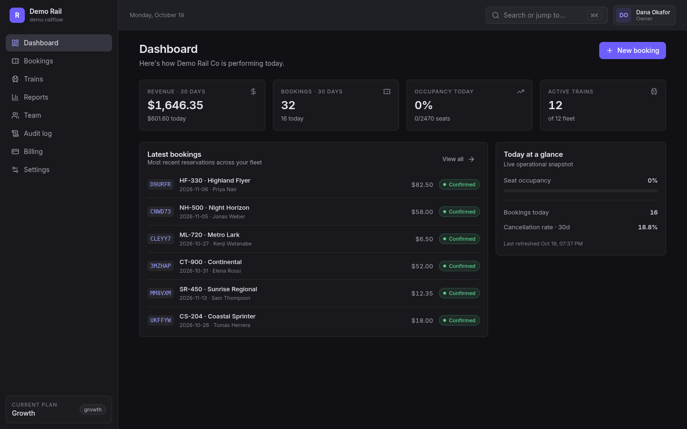 | 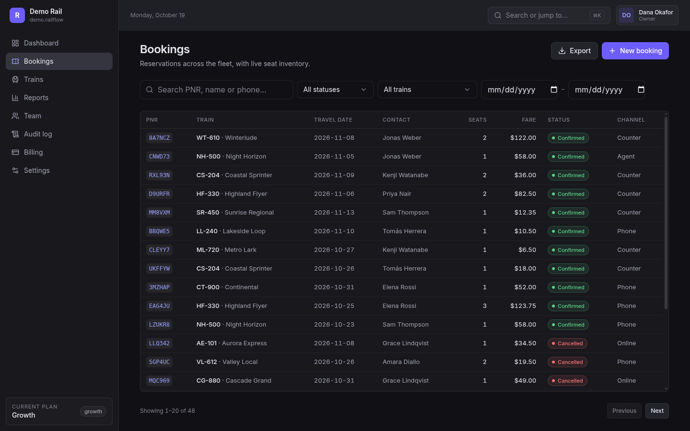 |

| Trains and schedules | Reports |
|---|---|
| 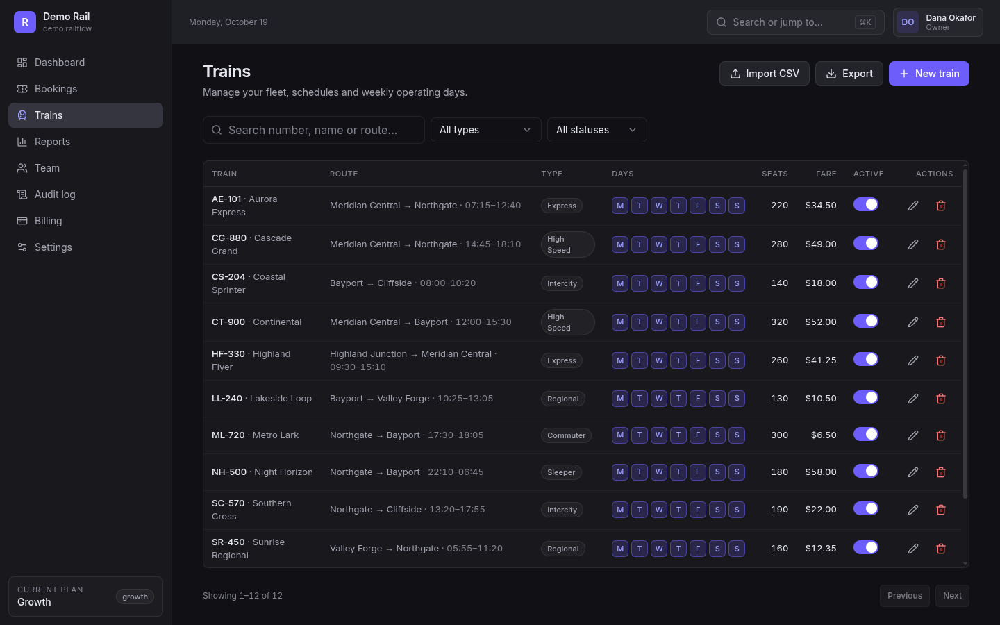 | 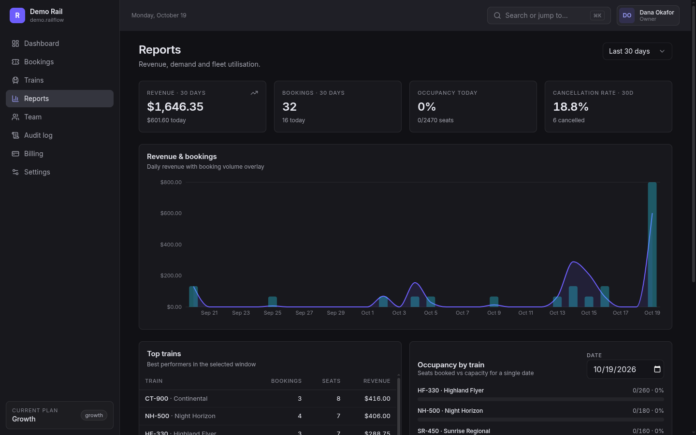 |

<details>
<summary><strong>More screens — team, billing, settings, audit log and mobile</strong></summary>

| Team and roles | Billing and quotas |
|---|---|
| 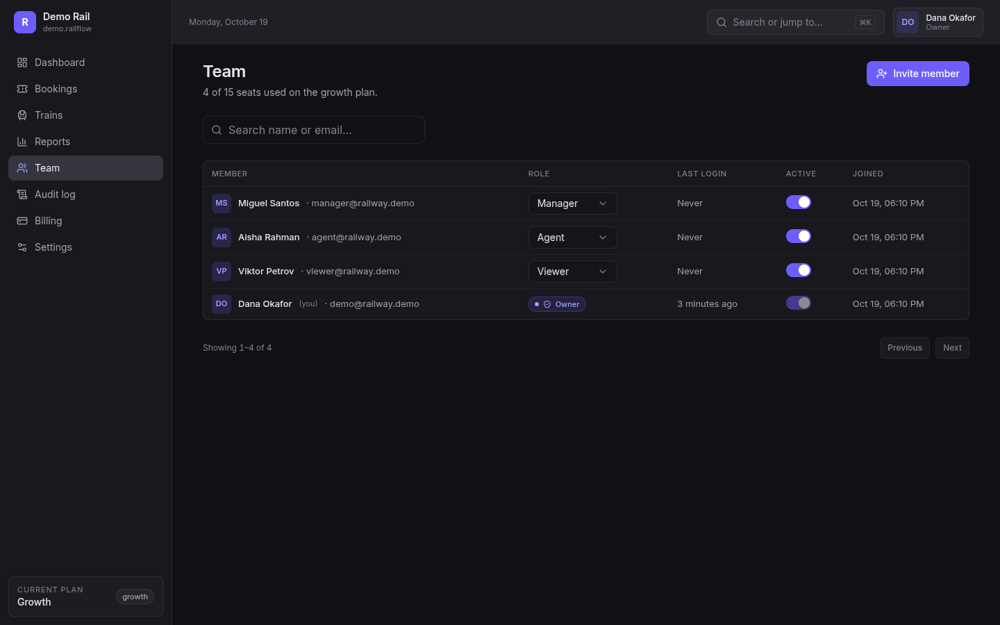 | 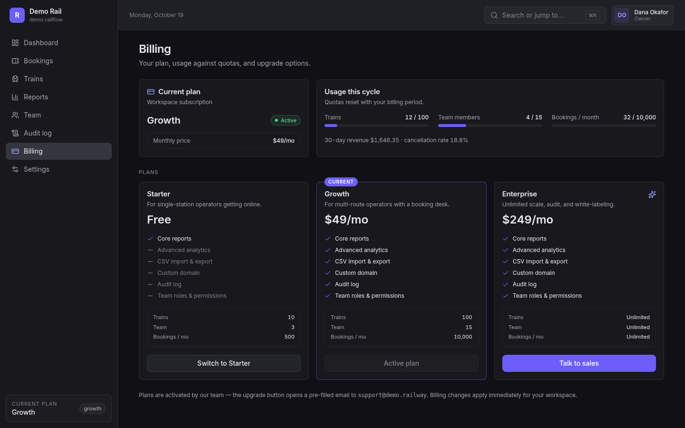 |

| Branding and workspace settings | Audit log |
|---|---|
| 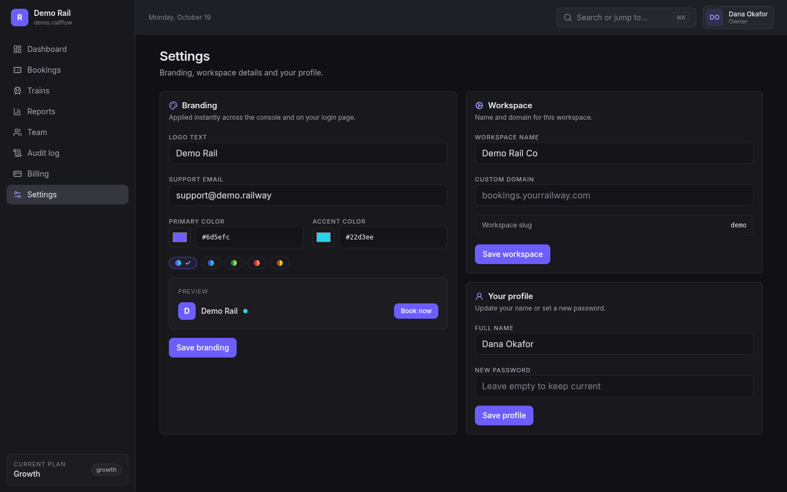 | 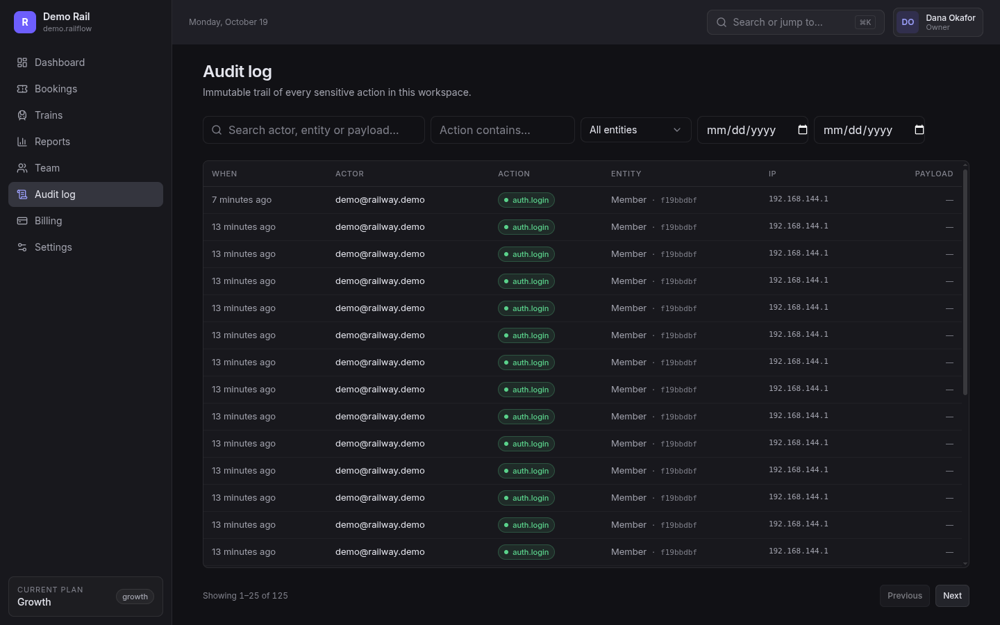 |

| Mobile bookings | Mobile dashboard |
|---|---|
| 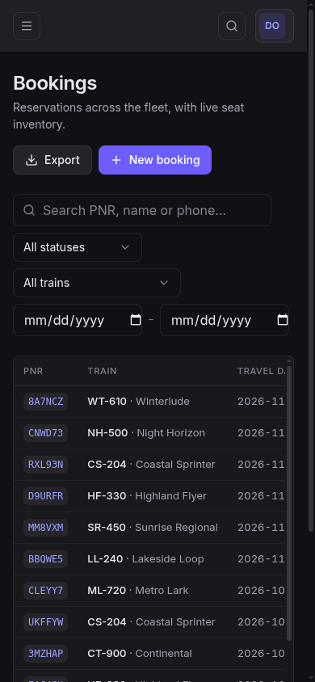 | 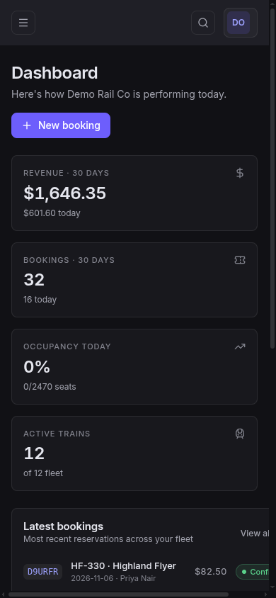 |

</details>

## Features, and who they are for

| If you are… | RailFlow gives you… |
|---|---|
| **Owner or operator** | The whole business in one place: revenue, bookings, fleet, staff, plans and branding. |
| **Booking agent** | A fast counter/phone/agent workflow with PNRs, passenger lists and instant seat checks. |
| **Operations manager** | Schedules, routes, operating days, per-date inventory and CSV import/export. |
| **Finance or revenue** | Revenue and booking trends, occupancy, cancellation rate and CSV exports. |
| **IT or self-hoster** | A Dockerised Next.js + FastAPI + PostgreSQL stack with database-enforced tenant isolation. |

### Bookings that cannot double-sell

*For agents, managers and owners.* Create a booking against a specific train and travel date, for up to 10 seats, with a contact, a passenger list, a sales channel (`counter`, `phone`, `agent`, `online`) and optional notes. RailFlow checks live inventory inside a database row lock, issues a unique PNR, and returns `409` with the remaining seats if the train is full. Search and filter by PNR, name, phone, status, train or date range; open any row for the full booking; cancel with refund state tracked. The demo has 48 bookings to explore.

### Fleet, schedules and seat inventory

*For operations.* Add trains with number, name, type, source, destination, departure and arrival times, stops, running days, total seats and fare. Every train has a weekly schedule and a per-date inventory ledger, so the same train can be sold on any operating day without clashes. Activate or retire a train with one switch, export the fleet, or import a timetable from CSV on Growth and Enterprise.

### Dashboard and reports

*For owners and finance.* The dashboard shows 30-day revenue, 30-day bookings, today's occupancy and active trains, plus the latest reservations and a live operational snapshot. Reports add a revenue-and-bookings chart, occupancy, cancellation rate and date ranges; Growth and Enterprise can export the numbers to CSV for accounting or board packs.

### Team and permissions

*For owners and managers.* Invite staff by email, assign a role and deactivate access instantly. Roles are enforced by the API, not just hidden in the interface:

| Role | What they can do |
|---|---|
| **Owner** | Everything: billing, team, branding, fleet, bookings, reports, audit. |
| **Manager** | Run day-to-day operations: bookings, fleet, reports and team operations. |
| **Agent** | Sell, change and cancel bookings; view schedules and inventory. |
| **Viewer** | Read-only access to the dashboard, bookings, fleet and reports. |

Seats are limited by plan — the Team page shows exactly how many of your allowance are in use.

### Audit log

*For owners and compliance.* Every sensitive action is written to an append-only trail with actor, action, entity, IP address and payload. Filter by actor or entity text, action, entity type and date range. Audit access is a paid-plan feature, so Starter workspaces cannot quietly inspect or disable it.

### Branding, plans and billing

*For owners.* Settings controls the workspace name, logo text, primary and accent colors, support email, profile and custom domain (Growth and Enterprise). The branding is applied to the console and the sign-in page immediately. Billing shows the current plan, usage against every quota, and the other plans; plan changes update entitlements and limits at once. In this repository, plan activation is handled by your team through a pre-filled support email — the Stripe webhook endpoint is included so real payment collection can be wired in without changing the entitlement model.

### Multi-tenant security

*For IT.* One deployment serves many companies. Every table carries a `tenant_id`; every request sets a transaction-local tenant; PostgreSQL row-level security is enabled and forced, so even the schema owner is filtered. The runtime role cannot bypass RLS and the app refuses to start if it could. Passwords use argon2id, sessions use short-lived JWT access tokens plus refresh tokens, and login requires the workspace slug with generic errors to prevent account enumeration.

## Plans

| | Starter | Growth | Enterprise |
|---|---|---|---|
| Price | Free | **$49/mo** | **$249/mo** |
| Trains | 10 | 100 | Unlimited |
| Team members | 3 | 15 | Unlimited |
| Bookings per month | 500 | 10,000 | Unlimited |
| Core reports | ✔ | ✔ | ✔ |
| Advanced analytics + CSV | — | ✔ | ✔ |
| Audit log | — | ✔ | ✔ |
| Team roles & permissions | — | ✔ | ✔ |
| Custom domain | — | ✔ | ✔ |

Limits are enforced server-side per request, and per-workspace overrides are supported for special deals.

## 🌱 Beginner guide — read this and you are a professional

Never worked for a railway? Never opened a booking system? Start here. Every term is explained, and by the end of this section you will understand the product better than most people who use one every day.

### The one-sentence version

RailFlow is a shared, always-current list of every seat on every train — plus the tools to sell those seats, change them, and report on them.

### The mental model

- **A workspace is one company's private office.** The slug (`demo`, `northline`, `starter`) identifies which office you are entering. People from one office can never see another office's data, even though everyone uses the same website.
- **A train is a reusable service, not a single departure.** "Aurora Express, 07:15, Meridian Central → Northgate" is the service. It runs on chosen weekdays. Each calendar date gets its own inventory, so selling 20 seats for Monday does not touch Tuesday.
- **A booking is a promise of seats on one date.** It gets a **PNR** — the short code (for example `8A7NCZ`) that identifies it at the counter, on the phone and in the audit log.
- **A seat is inventory, not a number on a chart.** The system counts how many seats are left for that date and refuses to sell more than exist.
- **A role is a job description with a key.** Owners unlock everything, managers run operations, agents sell tickets, viewers only look.

### Words you will hear

| Word | Plain meaning |
|---|---|
| **Workspace / tenant** | One company's account. Same software, separate data, own users and branding. |
| **PNR** | Passenger Name Record — the unique code for a booking. |
| **Route** | Where a train starts and ends, plus any stops in between. |
| **Schedule** | Departure and arrival times, and which weekdays the train runs. |
| **Inventory** | How many seats are still available on a specific train and date. |
| **Fare** | The price of one seat, stored in cents to avoid rounding errors. |
| **Occupancy** | Seats sold divided by seats available, usually shown as a percentage. |
| **Cancellation rate** | Cancelled bookings divided by total bookings in a period. |
| **Entitlement** | A feature or limit that comes with a plan and is checked by the server. |
| **Audit log** | The permanent record of who did what, when, and from where. |
| **CSV** | A plain spreadsheet file that other tools can open. |
| **Custom domain** | Your own web address (for example `bookings.yourrailway.com`) instead of a shared one. |

### Your first ten minutes

1. **Sign in.** Use workspace `demo`, email `demo@railway.demo`, password `demo1234` (or press **Use demo credentials**). You land on the dashboard.
2. **Read the dashboard.** Four tiles answer four questions: how much did we earn in 30 days, how many bookings came in, how full are today's trains, and how many trains are active. Below them, the latest bookings and today's operational snapshot.
3. **Sell a ticket.** Open **Bookings → New booking**. Choose a train and date, set 1–10 seats, enter the contact, add each passenger, pick a channel and confirm. A new PNR appears at the top of the list and the seat count drops immediately.
4. **Open a booking.** Click any row. You will see the contact, journey, passengers, seat count and fare — and the controls to cancel it.
5. **Add a train.** Open **Trains → New train**, fill in the number, name, route, times, running days, seats and fare, then save. It is immediately sellable.
6. **Check the money.** Open **Reports**, change the date range and read the revenue-and-bookings chart, occupancy and cancellation rate. On Growth, export the numbers.
7. **Invite a colleague.** Open **Team → Invite member**, choose a role and send the invite. Toggle **Active** off when someone leaves.
8. **Inspect the trail.** Open **Audit log** and filter by action or entity. This is what an auditor sees.
9. **Make it yours.** Open **Settings**, change the logo text and colors, watch the preview, and save. Add a custom domain if your plan includes it.
10. **Review the plan.** Open **Billing** to see usage against quotas and what the next plan unlocks.

### A day in the life

**Aisha is on the counter.** A customer wants three seats to Northgate tomorrow. She opens Bookings, creates the booking, adds the passengers, takes the fare and reads back the PNR. Thirty seconds, no paper chart.

**Miguel runs operations.** He adds a Friday-only commuter service, imports a timetable CSV, then checks that tomorrow's occupancy is healthy. When a train is withdrawn, he switches it off so nobody sells it.

**Dana owns the company.** She opens the dashboard before her coffee, checks the cancellation rate in Reports, invites a new agent, and confirms the workspace is on the right plan for the season.

### Why the safety net matters

- **No double-selling.** Inventory is checked inside a database lock; the second agent gets a clear "not enough seats" answer with the number actually left.
- **No cross-company leaks.** Row-level security is enforced by PostgreSQL on every query, not by remembering to filter in application code.
- **No silent changes.** Sensitive actions are written to the audit log with the actor and IP.
- **No mystery limits.** Plan quotas are checked on the server, and the Billing page shows exactly where you stand.

### You are now a professional if you can…

- Explain workspace, PNR, inventory, entitlement and audit log to a colleague.
- Sell, find and cancel a booking without asking for help.
- Add a train and describe which dates it can be sold on.
- Read the dashboard and reports and say whether the month is going well.
- Explain why two agents cannot sell the same last seat.

## Architecture

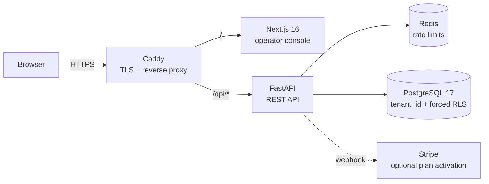

- **Tenancy** — shared schema, `tenant_id` on every row, transaction-local `app.current_tenant`, fail-closed policies and `FORCE ROW LEVEL SECURITY`.
- **Auth** — argon2id hashes, JWT access and refresh tokens carrying the tenant claim; workspace slug required at login.
- **Booking safety** — `SELECT … FOR UPDATE` on the inventory row, unique PNR retries, `409` with `details.seats_left` when full.
- **Entitlements** — per-plan features and quotas, per-tenant overrides, enforced server-side; billing only changes the plan.

## Testing & verification

This is not a demo that was clicked twice. Every claim above is backed by automated checks:

- **Backend:** 107 pytest tests against a real PostgreSQL, including proof that RLS is enabled, forced and cannot be bypassed by the runtime role; **81% coverage**, Ruff clean.
- **Frontend:** 60 Vitest tests at **100% statements, lines and functions** (92% branches); TypeScript and ESLint clean.
- **End to end:** 30 Playwright checks on desktop Chromium and a mobile profile — authentication, bookings, trains, reports, team, audit, accessibility (WCAG 2.1 AA) and visual snapshots.
- **Load:** k6 smoke, load and stress scenarios with explicit thresholds (`p95 < 500 ms`, error rate `< 1%`).
- **CI:** a three-job GitHub Actions pipeline runs backend tests, frontend lint/typecheck/coverage/build and the full E2E suite against a real Docker stack.

Full evidence, commands and the CI gate map live in [docs/TESTING.md](docs/TESTING.md).

```sh
make test              # backend pytest
make fe-test           # frontend Vitest
make fe-test-coverage  # coverage thresholds
make fe-e2e-up         # compose stack with permissive limits for E2E
make fe-e2e            # Playwright E2E + accessibility (+ visual with E2E_VISUAL=1)
```

## Project layout

```text
backend/
  app/
    core/        config, security, errors, pagination, rate limiting
    db/          engine/session, RLS helpers, tenant-table registry
    identity/    tenants, members, plans, entitlements, auth, team, settings
    trains/      catalog, schedules, per-date inventory, CSV
    bookings/    PNR allocation, seat locking, cancel/refund state
    reports/     occupancy, revenue, cancellations
    audit/       immutable audit trail (paid plans)
    billing/     Stripe webhook → plan switch
    public/      unauthenticated tenant resolution and plan catalog
    seed.py      idempotent demo workspaces
  alembic/       migrations (0001 = full schema + RLS)
  tests/         pytest against a real PostgreSQL
frontend/
  src/app/       Next.js operator console and auth pages
  e2e/           Playwright suite, accessibility and visual baselines
docs/
  TESTING.md     verification evidence and CI gates
  DECISIONS.md   architecture decisions with sources
  assets/        screenshots, tour GIF, social banner
infra/
  postgres/      role bootstrap and init SQL
  caddy/         reverse proxy and TLS configuration
  k6/            load-test scenarios
  demo/          product-tour recorder
```

## Deployment

Copy `.env.example` to `.env`, set `SECRET_KEY` (`openssl rand -hex 32`) and production database passwords, point `SITE_ADDRESS` at your domain (and `*.your.domain` for workspace subdomains), set `SEED_DEMO=false`, and keep ports `80`/`443` open (TCP and UDP for HTTP/3). Caddy obtains and renews certificates automatically; wildcard certificates use the DNS-01 challenge. See [docs/DECISIONS.md](docs/DECISIONS.md) for the verified choices behind tenancy, TLS, custom domains and billing.

**Publish the showcase.** The one-page site lives in `docs/index.html`, ready for GitHub Pages: **Settings → Pages → Deploy from a branch → `main` → `/docs`**. Upload `docs/assets/hero-banner.png` (1280×640) as the repository social preview under **Settings → Social preview**.

## FAQ

**Can two agents sell the same last seat?** No. Inventory is locked for the duration of the booking, and the loser of the race receives a `409` with the seats actually remaining.

**Can one deployment host several companies?** Yes. Every workspace is isolated by PostgreSQL row-level security, with its own users, branding, plan and quotas. Workspaces are addressed by slug, and subdomains/custom domains are supported.

**Do I need Stripe to use RailFlow?** No. Plans, entitlements and quotas work without any payment provider. The repository includes a signature-verified Stripe webhook endpoint for when you want to connect real billing.

**Can I import our existing timetable?** Yes, from CSV on the Trains page (Growth and Enterprise). The fleet and report data can also be exported.

**Does it work on a phone?** Yes — the console is responsive. Mobile screenshots for bookings and the dashboard are above.

**Is it production-ready?** The core product is complete and heavily tested, but before charging customers you should finish the production checklist and wire real payment collection. The known gaps are listed in [docs/TESTING.md](docs/TESTING.md).

**Where can I see the evidence?** [docs/TESTING.md](docs/TESTING.md) contains the test map, coverage numbers, CI gates and the honest list of what is intentionally out of scope.

## License

Proprietary — all rights reserved. No open-source license is granted.
